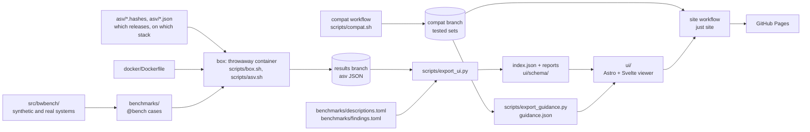

# How it works

The repository times Brightway's packages release by release and shows the history on a
static site. Four things happen in order: asv builds and times each release inside a throwaway
box, the timings are committed to a `results` branch, a script turns them into JSON files with a
fixed shape, and a static viewer draws those files.

## What gets timed

- [`asv/`](../asv/) holds one `SUBJECT.hashes` file per Brightway package (`bw2calc`, `bw2data`,
  `bw_graph_tools`, `bw_processing`, `bw_timex`, `matrix_utils`): the releases and commits to
  time. `bw2calc-conda` is a seventh file, a second bw2calc suite on conda-forge's builds.
  `SUBJECT.json` is asv's configuration and `SUBJECT.stack.txt` is the fixed set of
  dependencies every release runs on, so a timing change belongs to the subject and not to its
  dependencies. [`scripts/asv_conf.py`](../scripts/asv_conf.py) reads these files.
- [`benchmarks/`](../benchmarks/) has one `bench_SUBJECT/` folder per package. A case is a setup
  function marked `@bench` that returns the call to time and a check of its result
  ([`src/bwbench/bench.py`](../src/bwbench/bench.py)). One case runs under asv
  ([`src/bwbench/asv.py`](../src/bwbench/asv.py)) and under CodSpeed
  ([`src/bwbench/pytest.py`](../src/bwbench/pytest.py), suites in [`benchmarks/codspeed/`](../benchmarks/codspeed/)).
- [`src/bwbench/`](../src/bwbench/) builds the systems the cases run on. Seeded synthetic
  systems come from [`src/bwbench/synth.py`](../src/bwbench/synth.py) and the shapes in
  [`src/bwbench/shapes.py`](../src/bwbench/shapes.py); the profile definitions are in
  [`src/bwbench/profiles/`](../src/bwbench/profiles/). USEEIO and BAFU are read from their
  archives ([`src/bwbench/useeio.py`](../src/bwbench/useeio.py), [`src/bwbench/bafu.py`](../src/bwbench/bafu.py)).
  [`src/bwbench/matrices.py`](../src/bwbench/matrices.py) holds a system and its reference scores.
  [`docs/method.md`](method.md) says what is measured and why the systems look as they do.

Not to be confused with the above: the top-level [`profiles/`](../profiles/) folder holds
pyinstrument reports that a finding links to, not synthetic profiles.

## Where it runs

On your machine, Brightway's code runs only in the box: a container built from
[`docker/Dockerfile`](../docker/Dockerfile) that sees this repository and nothing else.
[`scripts/box.sh`](../scripts/box.sh) starts it and
[`scripts/asv.sh`](../scripts/asv.sh) runs asv inside it. [`justfile`](../justfile) names the
recipes (`just smoke`, `just bench`). Every recipe and variable is in [`docs/running.md`](running.md).

A hosted CI runner is a throwaway machine too, so the `codspeed` and `cold-install` workflows
install Brightway straight onto it.

## Where results go

asv writes its result files into a checkout of the `results` branch.
That branch holds data only. `just results-commit`
([`scripts/results-commit.sh`](../scripts/results-commit.sh)) checks the files and commits
them there. A separate `compat` branch holds the tested install sets that the
[compat workflow](../.github/workflows/compat.yml) writes each night
([`scripts/compat.sh`](../scripts/compat.sh)).

## The data contract

[`scripts/export_ui.py`](../scripts/export_ui.py) reads that checkout and writes `index.json` and
one report per commit and subject. It also finds the changes between releases, so the viewer
computes none. The JSON Schemas in [`ui/schema/`](../ui/schema/) define the shape, and each file
carries a `format_version`. [`ui/src/lib/contract.ts`](../ui/src/lib/contract.ts) checks every
file against the schema and refuses a version it does not know.
[`benchmarks/descriptions.toml`](../benchmarks/descriptions.toml) and
[`benchmarks/findings.toml`](../benchmarks/findings.toml) supply the text beside the numbers.

## The viewer and the site

[`ui/`](../ui/) is an Astro project with Svelte components: the benchmark explorer, the Setup
page, the about page and the stories (pages in [`ui/src/pages/`](../ui/src/pages/)). It fetches
the JSON at runtime. [`ui/scripts/size.mjs`](../ui/scripts/size.mjs) holds the size budget.

The [site workflow](../.github/workflows/site.yml) checks out `main`, `results` and `compat`, runs
`just site` and `just ui-data`, builds the viewer and publishes everything on GitHub Pages at
<https://simonvanlierde.com/brightway-benchmarks/>. It runs daily and when the viewer or its data
scripts change on `main`.

## Other workflows

All of them are in [`.github/workflows/`](../.github/workflows/).

- Pull requests: `ui` (lint, types, tests, build, size, browser tests), `python`, `checks` (git
  hooks), `pr-title`, `dco`, `codspeed`, `fuzz` (when the release report script changes) and
  `cold-install` (when the README or the workflow changes).
- Scheduled: `compat` (nightly), `python-probe` (daily, plus the end-of-life Pythons on Mondays;
  [running](running.md#which-pythons-work)), `smoke` and `cold-install` (weekly, an install of a
  tested set in a clean container), `links` (weekly web link check), `fair` (weekly),
  `advisories`, `scorecard`.
- Manual: `noise-hosted` (the noise floor on a hosted runner) and `solvers-macos` (the solver
  comparison on an Apple Silicon runner).
- `release` makes the GitHub release when a `vX.Y.Z` tag is pushed.
